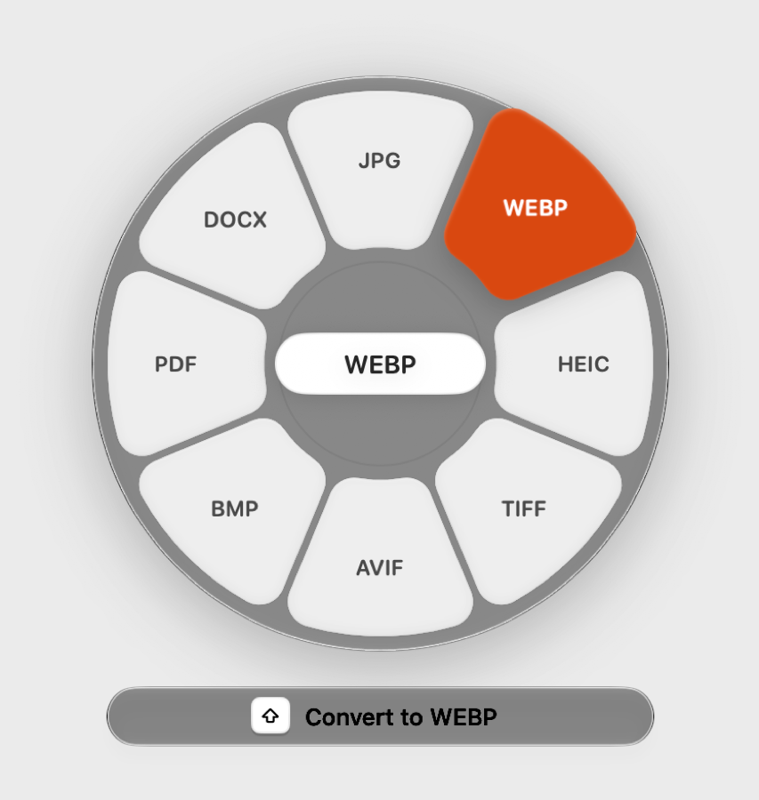
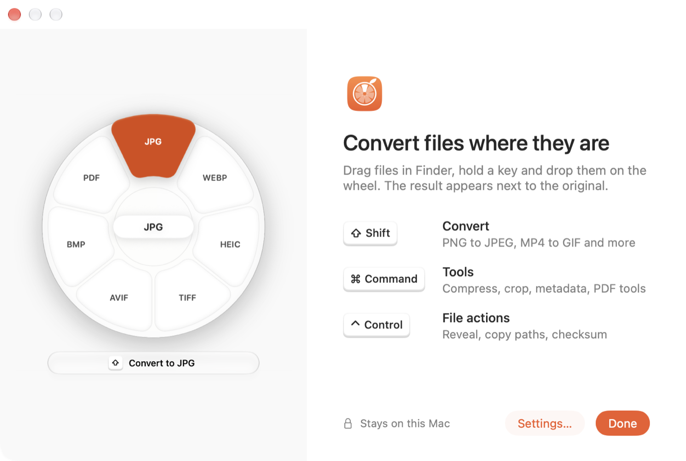

# Pomelo

**Drag a file, tap a key, drop it on the wheel.** Pomelo is a local file converter and toolbox for macOS. The result appears next to the original. Nothing leaves your Mac.

<p>
  
</p>

## How it works

| While dragging files in Finder | Wheel | Examples |
|---|---|---|
| tap **Shift** | Convert | PNG → JPEG, HEIC → WebP, MP4 → GIF or M4A, DOCX → PDF, CSV → XLSX |
| tap **Command** | Tools | compress, edit, annotate, crop, redact, remove background, read QR codes, PDF and video tools |
| tap **Control** | File actions | AirDrop, shelf, copy paths, move, ZIP, open in Terminal, SHA-256 |

You can release the key and keep dragging; the wheel stays open until you drop.

**Without dragging:** select files in Finder and press **⌃⌥ Space**. Choose with the arrow keys, **Return** to apply, **Escape** to close, **Command** or **Control** to switch wheels. All keys can be changed in Settings.



## What it converts

| Area | Formats and tools |
|---|---|
| Images | JPEG, PNG, HEIC, WebP, AVIF, TIFF, BMP, SVG (input), PDF; compress, resize, rotate, crop, edit, annotate, true redaction, remove background, add a background, collage, read QR and barcodes |
| PDF | to text, images, DOCX; merge, split, organize, compress (also to a target size, keeps form fields), PDF/A-2b, redact text for real, edit and annotate |
| Documents | DOCX, RTF, RTFD, HTML, TXT, Markdown and EPUB to each other and to PDF |
| Tables | CSV, TSV and XLSX to each other (first sheet, values) |
| Audio | MP3, M4A, WAV, FLAC, OGG, Opus, AIFF, WMA; trim, normalize, channels, bleep, compress |
| Video | MP4, MOV, MKV, WebM, AVI, WMV, GIF; input also FLV, MTS, MPG, 3GP; extract the sound track, trim, split, join, crop, speed, frames, redact, compress |
| Subtitles | SRT, VTT, TXT |
| Archives | ZIP, TAR and TAR.GZ to each other; extract ZIP, TAR, GZIP and RAR with checks against unsafe archives |

## Private by design

- No network access, no account, no analytics, no update check.
- Originals are never changed. A new file with an existing name becomes `name 2.ext`.
- Files are written to a temporary name first and renamed when complete.
- Archives are only unpacked, never run. The macOS "downloaded from the internet" mark stays on extracted files and is carried over to new archives, so Gatekeeper still checks their contents.

## Install from source

Requirements: macOS 15 or later, Xcode 26 or later (Swift 6.2 toolchain). Optional: [FFmpeg](https://ffmpeg.org) for many audio and video formats (`brew install ffmpeg`).

```sh
git clone https://github.com/juliandressler-ship-it/pomelo.git
cd pomelo
./scripts/build-app.sh
open dist.noindex/Pomelo.app
```

Move `Pomelo.app` to Applications to keep it, and turn on **Open at login** in Settings. The build is ad-hoc signed and not notarized, so macOS may ask you to confirm the first launch in System Settings → Privacy & Security.

Run the tests with `./scripts/test.sh`.

## Good to know

- Pomelo lives in the menu bar and has no Dock icon.
- The first time you use ⌃⌥ Space, macOS asks whether Pomelo may control Finder. This is only used to read the selected files.
- Exact Word or PowerPoint layouts are not reproduced; DOCX → PDF keeps text and formatting. Presentations, OCR and AI features are not included.

## License

GPL-3.0-only. See [LICENSE](LICENSE), [NOTICE](NOTICE) and [THIRD_PARTY_NOTICES.md](THIRD_PARTY_NOTICES.md) for copyright and attribution of the projects Pomelo is based on.

Developed by Julian Dressler.
